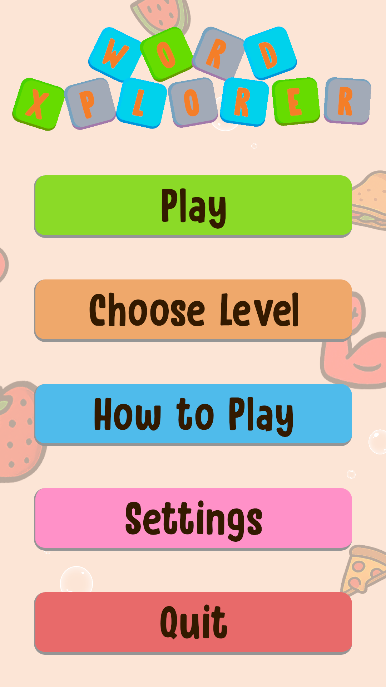
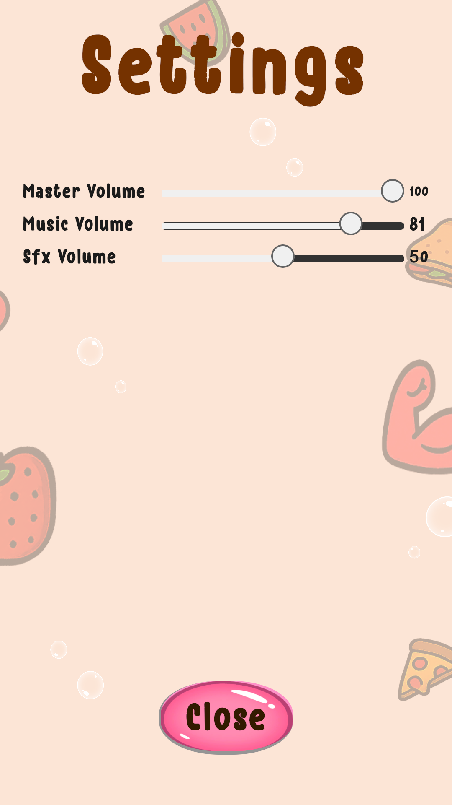

You can see all the related updates [here](/tags/wordxplorer)

This update is all about sound. WordXplorer now has background music, and a settings screen so you can control how loud everything is (or turn it off entirely without having to turn the phone audio down).

## Background Music

Last time I said the next step was letting you turn the sound off. Before I could do that, I needed something worth turning off besides the fireworks. So the game now has background music.

I bought an asset pack and picked a mix of 5 songs from it. They play in random order, and they play everywhere: the menu, the game, all of it. No more playing in silence.

### Settings Screen

The part that makes the music optional. There’s a new settings screen with three volume sliders:

- **Master** controls everything
- **Music** controls just the background tracks
- **SFX** controls the fireworks, tile flips and the rest

|           Main Menu           |          Settings           |
|:-----------------------------:|:---------------------------:|
|  |  |

I built it with UI Toolkit again, and Unity’s Audio Mixer made the three-slider setup pretty painless. There was one gotcha though. The mixer works in decibels, but a slider goes from 0 to 100. Feeding the slider value straight in sounds wrong because decibels are logarithmic. The fix is to convert the value first.

I also added a small state machine that handles switching between the main menu and the settings screen. This state machine should make it easier to add things like an interactive tutorial in the future.

<?# ResponsiveYouTube _Lc0Om46OFg Title="WordXplorer Settings Screen" /?>

### Price Increase on December 1

Heads-up: WordXplorer’s price goes up from $3.99 USD to $4.99 USD next month. If you’ve been thinking about picking it up, now’s the time. Or gift it to a friend.

### What’s Next

I’m planning to add a new theme, but I haven’t decided on one yet. If you have ideas for a theme, or any other feature or improvement you’d like to see, I’m all ears.

## Become a Beta Tester  
  
Want to help catch bugs before they reach the public? I’d love your help. Simply send me a screenshot of your app review, and I’ll add you to the beta team. As a thank you, I’ll also give you a **free copy of the app** to share with a friend!

## Get WordXplorer  
  
WordXplorer is available on the iOS App Store and Google Play Store.

<?# AppStoreBadges AppStoreLinkText="Get WordXplorer on App Store" AppStoreLinkUrl="wordxplorer-guess-the-word/id6504664783" GooglePlayLinkText="Get WordXplorer on Play Store" GooglePlayLinkUrl="com.glhf.wordleforkids"/?>

Want to try before you buy? Check out the [web demo here](https://wordxplorer.ankursheel.com/).

Thank you for being part of this journey. Stay tuned for more updates!
